<div align="center">

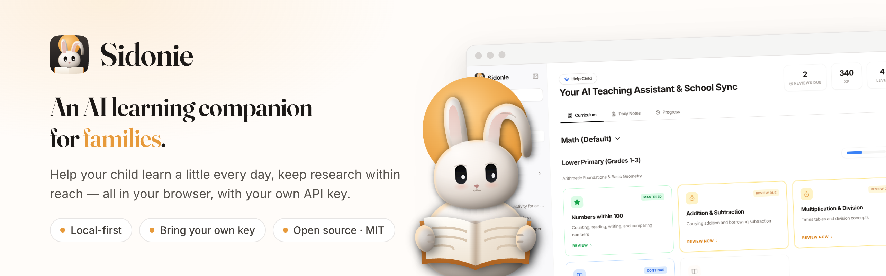

<h3>Sidonie: a local-first AI learning companion for families</h3>

Two things in one place: <b>help your child learn</b> a little every day, and give the grown-ups<br />
a proper <b>paper study workflow</b>: find, save, read, understand, annotate, review and cite.<br />
It all runs in your browser with your own API key. No account, no server.

[](https://github.com/melonlee/sidonie/actions/workflows/ci.yml)
[](./LICENSE)
[](https://melonlee.github.io/sidonie/app/)


**[Live demo](https://melonlee.github.io/sidonie/app/)** · [Website](https://melonlee.github.io/sidonie/) · [Features](#features) · [Paper study](#paper-study-from-radar-to-citation) · [Privacy](#privacy--your-data) · [Quick start](#quick-start) · [FAQ](#faq) · [中文](./README_zh.md)

<sub>by <a href="https://fantasyailab.com/">FantasyAI Lab</a></sub>

</div>

---

## Why Sidonie


Sidonie (Chinese name: 伴学, "learning companion") is named after my wife and inspired by our child. Every day I watched the two of them use AI tools that weren't really built for them. The tools were too generic for a child's homework and too scattered for a parent who still wants to keep up with research. So I built one place for both. It started with the people closest to me, and if it works for them it may work for your family too.

The mascot is a moon rabbit (玉兔), chosen for Sidonie because my wife loves rabbits; it peeks over the ledge in front of a full moon and belongs to the [FantasyAI Lab](https://fantasyailab.com/) mascot family.

Two pillars, one shared foundation:

| | For | What you get |
| --- | --- | --- |
| **Help Child** (帮孩子学) | your child, with you alongside | A curriculum map, concept and quiz cards, and spaced review. Learn a concept, practise, and come back when it's due. It isn't just a chat box. |
| **Paper study** (大人的论文学习) | the grown-ups | Paper Radar finds new arXiv papers; a reading list and a paper workspace take you from first skim to highlights, flashcards and a ready-made citation. |
| **Chat + Notes** | everyone | Multi-model chat and notes that both pillars save into. |

- **Private by default.** Chats, notes, your child's progress, your papers and your keys stay in your browser's storage.
- **Bring your own key.** Gemini, DeepSeek, Kimi or Qwen. Reading, highlighting, notes and flashcard review work without any key.

## Features

### Help Child: curriculum, cards, quizzes and spaced review

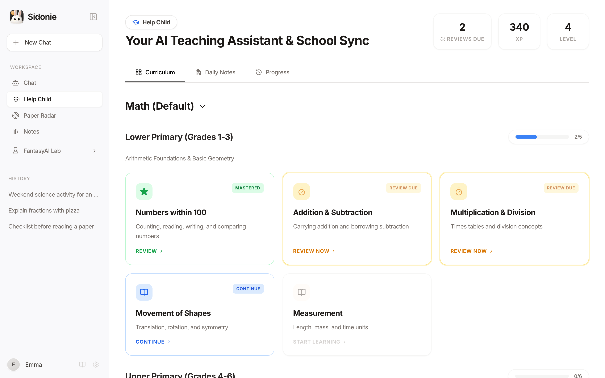

- **Curriculum map.** A built-in math path runs from Grade 1 to university. You can also generate a custom course for any subject and grade with AI.
- **Three kinds of learning cards.** Concept explanations (with follow-up questions), multiple-choice quizzes, and interactive HTML visuals.
- **Spaced review.** Each quiz answer reschedules the topic (1 day, 3 days, then longer). Topics your child struggled with come back sooner and are marked *Review Due*.
- **Motivation without pressure.** XP, levels and badges, plus a calendar of every session.
- **Daily notes from school.** Log the teacher's message (text or photos). AI can explain the key points for the parent or generate a few practice questions.

<table>
  <tr>
    <td width="50%">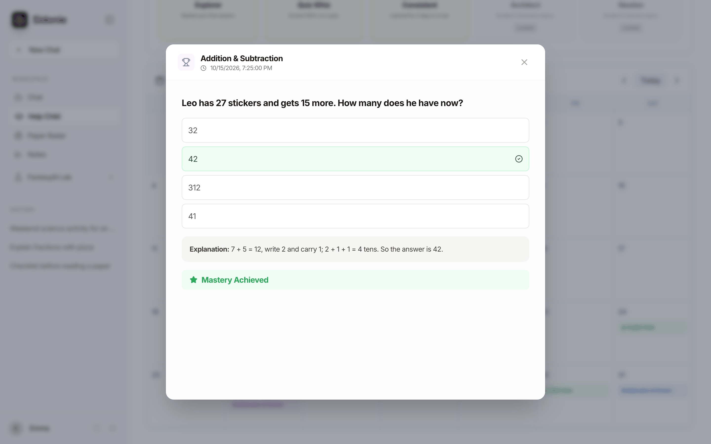</td>
    <td width="50%">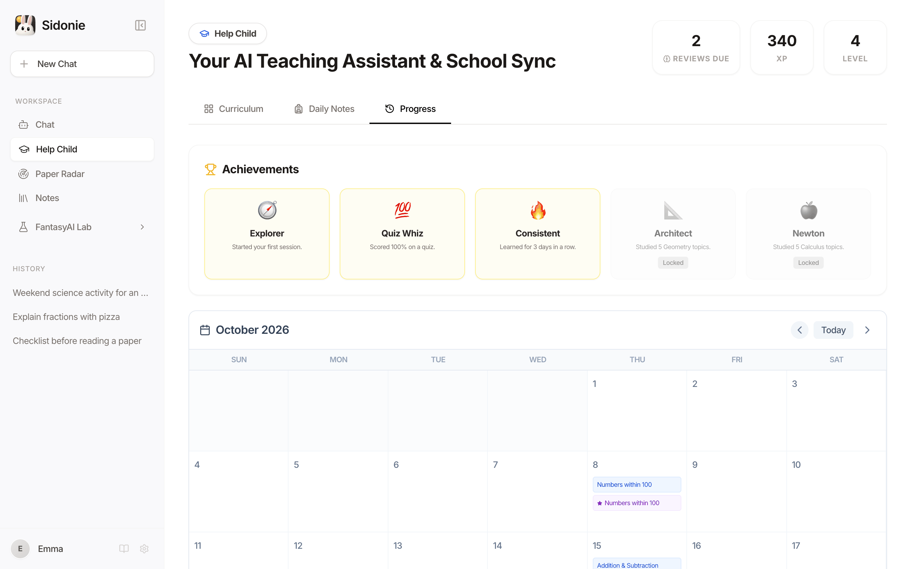</td>
  </tr>
  <tr>
    <td align="center"><sub>Quiz card with explanation</sub></td>
    <td align="center"><sub>Badges and the learning calendar</sub></td>
  </tr>
</table>

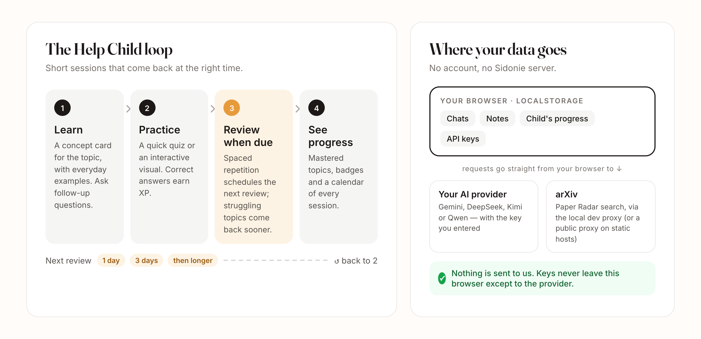

### Paper study: from radar to citation

Paper Radar used to be a feed of new arXiv papers. It is now a full study loop for the grown-ups:

**find → save → read → understand → annotate → review → cite**

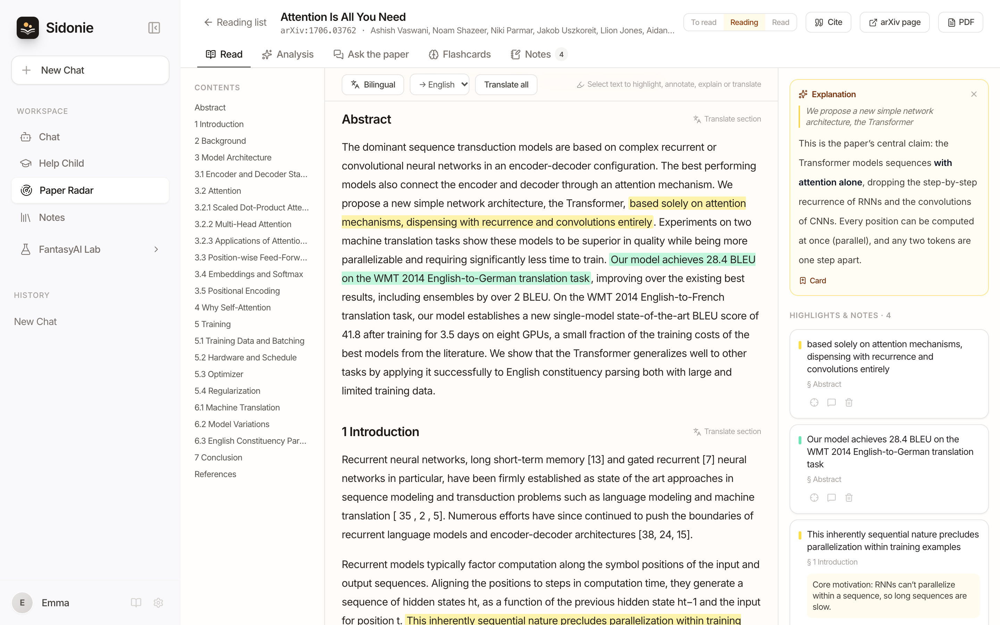

| Step | What Sidonie does |
| --- | --- |
| **Find** | Browse the newest arXiv papers by topic (LLM, Vision, Agents, Robotics, ML) or search keywords. **AI Deep Read** and a **Daily Briefing** summarise in English or Chinese. |
| **Save** | A reading list with *To read / Reading / Read*, tags, filters and sorting. Add papers from the feed, by **arXiv ID or URL**, or **import a local PDF**. The header shows real stats: papers, read this week, cards due, study streak. |
| **Read** | Full text extracted from the PDF in the browser (pdf.js, bundled, no CDN) into sections with a contents sidebar. **Bilingual mode** puts a paragraph-by-paragraph Chinese or English translation next to the original. |
| **Understand** | One-click **structured analysis** (TL;DR, question, method, contributions, results, limitations, prerequisites, who should read it). **Ask the paper**: answers cite the sections they used, retrieved locally with BM25. |
| **Annotate** | Select text to highlight in four colours, add a note, or have AI explain or translate the passage. A Markdown note per paper, and **Export to Notes** collects it all. |
| **Review** | Key-term **flashcards** reviewed on the same spaced-repetition schedule as Help Child. Due cards show up as "8 cards to review today". |
| **Cite** | Copy **BibTeX**, **APA 7** or **GB/T 7714-2015** in one click. |

<table>
  <tr>
    <td width="50%">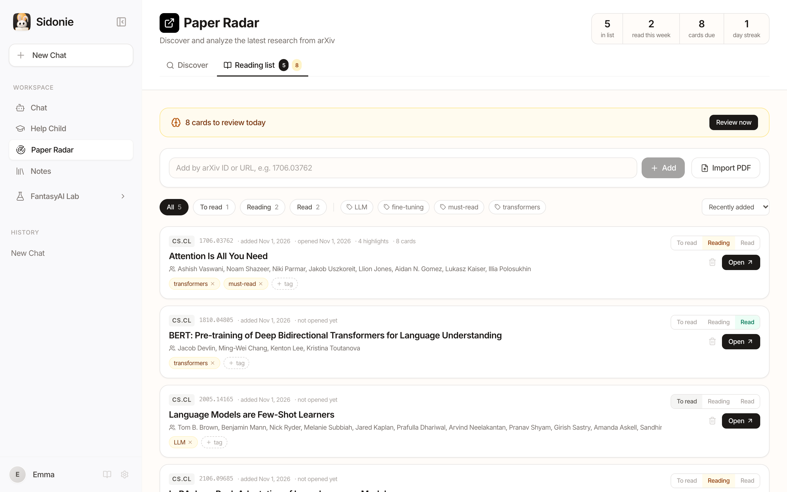</td>
    <td width="50%">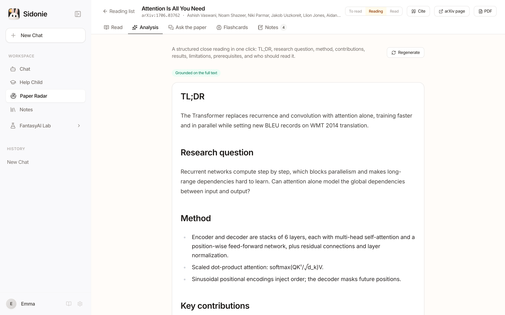</td>
  </tr>
  <tr>
    <td align="center"><sub>Reading list with status, tags and study stats</sub></td>
    <td align="center"><sub>Structured analysis, grounded in the full text</sub></td>
  </tr>
</table>

Good to know:

- **No key needed to study.** Reading, highlighting, notes, the reading list, flashcard review and citations all work without an API key. AI buttons explain how to add one.
- **Full-text extraction is heuristic.** Two-column layouts, headings and hyphenation are handled, but formulas, tables and figure text can come out garbled. Scanned PDFs (images only) have no text to extract, so you get abstract-only mode.
- **Text-only providers** (DeepSeek, Kimi, Qwen) receive extracted text, trimmed to fit the model's context.
- **Where it's stored.** The reading list, highlights and flashcards live in `localStorage`; PDFs, extracted text, translations, analyses and chats live in IndexedDB.
- The AI panels in these screenshots (explanation, analysis, translation, flashcards) show hand-written demo text, not real model output.

Full guide with every tab explained: **[docs/paper-study.md](./docs/paper-study.md)**.

### Chat and Notes: the shared foundation

<table>
  <tr>
    <td width="50%">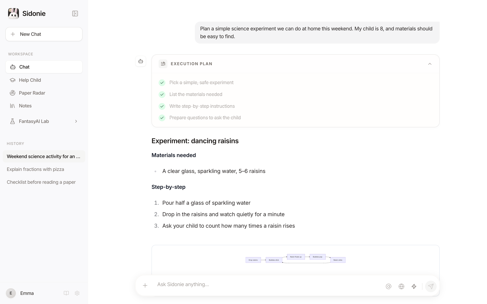</td>
    <td width="50%">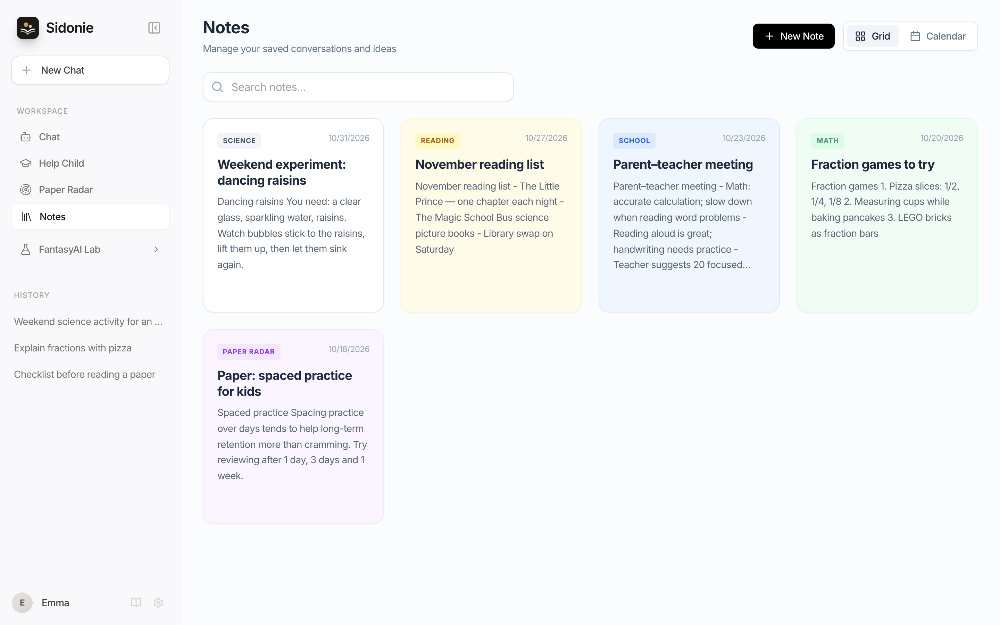</td>
  </tr>
  <tr>
    <td align="center"><sub>Chat with plans, Markdown and Mermaid diagrams</sub></td>
    <td align="center"><sub>Notes with tags, grid and calendar views</sub></td>
  </tr>
</table>

- Multi-session chat with streaming replies, plus file uploads (PDF, Word `.docx`, CSV, TXT and images).
- Complex requests show a step-by-step plan. Markdown, code, tables and Mermaid diagrams render inline, and HTML can be previewed live.
- Mention a note with `@` to add it as context, and save any answer to Notes. You can export answers as Markdown or Word.
- Optional Google Search grounding (Gemini) and image generation ("Draw …", needs a Gemini key).
- English and Chinese UI.

### Works on a phone, too

<p align="center">
  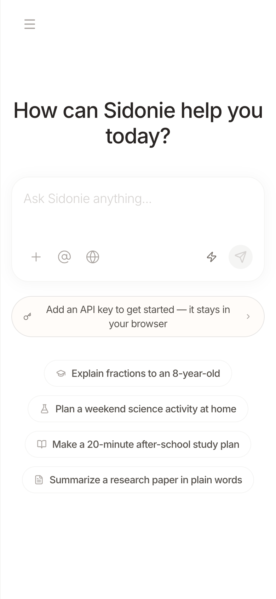
  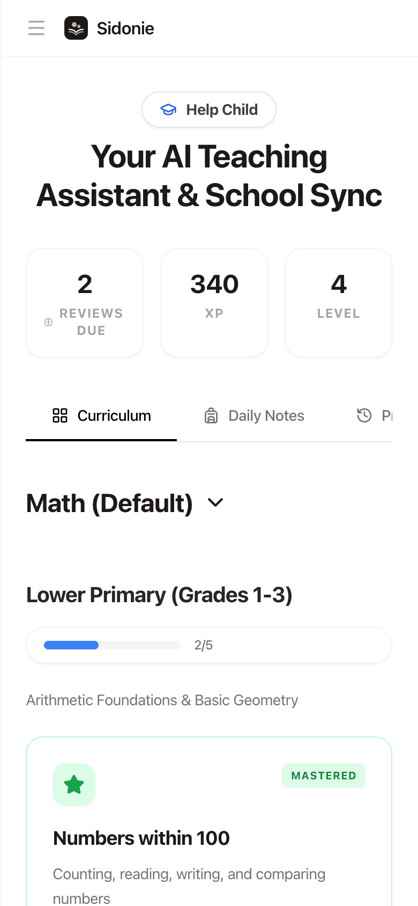
  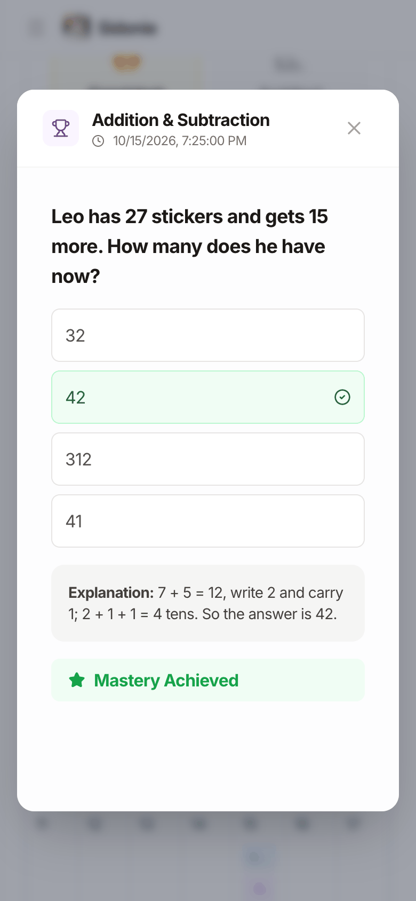
</p>

## Privacy & your data

Sidonie is a static web app. There is **no Sidonie backend, no account and no analytics**.

| What | Where it lives / where it goes |
| --- | --- |
| Chats, notes, your child's progress, settings, reading list, highlights, flashcards | `localStorage` in your current browser only |
| Paper PDFs, extracted text, translations, analyses, paper chats | IndexedDB in your current browser only |
| API keys | `localStorage` in your browser. They are sent only to the provider you pick and are **never** built into the app bundle |
| AI requests | Straight from your browser to Google Gemini, DeepSeek, Moonshot (Kimi) or Alibaba DashScope (Qwen) |
| Paper Radar searches and PDFs | arXiv. Its metadata API doesn't allow direct browser calls (CORS), so see below |

**Paper Radar and CORS.** With `npm run dev` or `npm run preview`, searches go through a small proxy built into the local Vite server. A static deployment such as GitHub Pages can't run a proxy. There, Sidonie first tries your own proxy (`VITE_ARXIV_PROXY`, if set) and then falls back to the public [allorigins.win](https://allorigins.win) proxy. That third-party service sees your search keywords and nothing else, and the app tells you when it was used. Public proxies can be slow or down, so run Sidonie locally for the most reliable Paper Radar. arXiv PDFs do allow cross-origin requests, so full-text reading works on static hosting too, and **Add by ID** still saves a paper when the metadata API is unreachable.

Tips: use API keys with spending limits. On a shared computer, use **Settings → Remove all keys** when you're done. Clearing your browser's site data deletes everything, and there is no cloud sync yet.

## Quick start

Requirements: Node.js 20+ and an API key from at least one provider.

```bash
git clone https://github.com/melonlee/sidonie.git
cd sidonie
npm install
npm run dev        # http://localhost:3000
```

Open **Settings → API Keys**, paste a key, and you're ready. You don't need an `.env` file.

| Provider | Models in Sidonie | Get a key |
| --- | --- | --- |
| Google Gemini | Gemini 3 Flash / Pro / Flash Lite, image generation | [aistudio.google.com/apikey](https://aistudio.google.com/apikey) |
| DeepSeek | DeepSeek V3 (`deepseek-chat`), R1 (`deepseek-reasoner`) | [platform.deepseek.com](https://platform.deepseek.com/api_keys) |
| Kimi (Moonshot) | `moonshot-v1-8k` | [platform.moonshot.cn](https://platform.moonshot.cn/console/api-keys) |
| Qwen (DashScope) | Qwen Plus, Qwen Max | [bailian.console.aliyun.com](https://bailian.console.aliyun.com/?apiKey=1) |

Help Child and Paper Radar use Gemini when a Gemini key is set. Otherwise they automatically use the first other provider you've configured.

Other scripts:

```bash
npm run build      # production build into dist/
npm run preview    # serve the build locally (includes the arXiv proxy)
npm run typecheck  # tsc --noEmit
npm test           # vitest (SRS, BM25, citations, text sections, paper store)
```

### Deploy your own copy

The app is fully static, so any static host works.

- **GitHub Pages:** `.github/workflows/deploy-pages.yml` builds and publishes on every push to `main`. Turn it on under *Settings → Pages → Source: GitHub Actions*. The workflow sets `VITE_BASE=/<repo-name>/` for you.
- **Elsewhere:** run `VITE_BASE=/your/sub/path/ npm run build`, or leave `VITE_BASE` unset to serve from the root.
- **Optional:** set `VITE_ARXIV_PROXY` to a CORS proxy you control (a prefix to which the encoded arXiv URL is appended) so Paper Radar doesn't depend on a public proxy. On GitHub, add it as a repository *variable*.

**Project website:** <https://melonlee.github.io/sidonie/> (Chinese + English). Source in [`website/`](./website/), plain HTML/CSS with no build step. One GitHub Pages deployment serves the website at the root and the app under `/app/`; see [website/README.md](./website/README.md).

## Tech stack

React 19 · TypeScript · Vite 6 · Tailwind CSS 3 (+ typography) · `@google/genai` + OpenAI-compatible fetch · react-markdown · Mermaid · mammoth (Word parsing) · pdf.js · localStorage + IndexedDB (idb-keyval) · Vitest

```
App.tsx                      app shell: sidebar, chat, settings
components/StudyView.tsx     Help Child (curriculum, cards, quizzes, review, daily notes)
components/AcademicView.tsx  Paper Radar (arXiv feed, reading list, workspace entry)
components/paper/            paper study: reader, PDF text, analysis, Q&A (BM25), flashcards, citations
services/srs.ts              spaced-repetition scheduler shared by Help Child and paper flashcards
components/NotesView.tsx     Notes
services/geminiService.ts    model routing, streaming, BYOK key handling
constants.ts                 models, prompts, default curriculum, en/zh strings
docs/assets/brand/           moon-rabbit icons and favicons, logo (incl. 伴学 wordmark), banners, posters (+ SVG masters and build scripts in src/)
website/                     static project website, deployable on its own (see website/README.md)
```

## Roadmap

Ideas we'd like to build next. None of these exist yet, and contributions are welcome:

- [ ] Several child profiles in one family
- [ ] Export / import all data as a JSON backup
- [ ] More built-in curricula (Chinese, English, science)
- [ ] Installable PWA with offline access to saved content
- [ ] A one-file arXiv proxy (e.g. Cloudflare Worker) template
- [ ] Automated tests for model routing (the review scheduler and paper tools are covered)

## FAQ

<details>
<summary><b>Is it free?</b></summary>

Sidonie itself is free and open source (MIT). You pay your AI provider for what you use with your own key, and many providers offer a free tier.
</details>

<details>
<summary><b>Do I need to run a server?</b></summary>

No. `npm run dev` is enough on your own machine, or you can host the static build anywhere. The only optional server piece is a CORS proxy for Paper Radar on static hosts.
</details>

<details>
<summary><b>Is my API key safe?</b></summary>

The key is stored unencrypted in your browser's `localStorage` and is sent only to the provider it belongs to. Anyone with access to that browser profile could read it, so use keys with spending limits and remove them on shared devices.
</details>

<details>
<summary><b>Why does Paper Radar fail on the live demo?</b></summary>

arXiv doesn't allow direct browser requests, and the demo relies on a public CORS proxy that is sometimes unavailable. Run locally (`npm run dev`) or set `VITE_ARXIV_PROXY` to your own proxy.
</details>

<details>
<summary><b>Which ages and subjects does it cover?</b></summary>

The built-in path is mathematics from early primary school to university. "Create Course" asks the model to draft a curriculum for any subject and grade.
</details>

<details>
<summary><b>Can my child use it alone?</b></summary>

It's designed for a parent and child to use together. AI-generated explanations and quizzes can contain mistakes, so look over the content with your child.
</details>

## Contributing

Issues and pull requests are welcome. Before opening a PR, please run:

```bash
npm run typecheck && npm test && npm run build
```

## About

Sidonie is built by **Melon (李辉)**, an AI full-stack engineer and the founder of [FantasyAI Lab](https://fantasyailab.com/), who builds reliable AI agents, multi-agent systems and practical AI products. Read more at [fantasyailab.com](https://fantasyailab.com/) and on [Melon's profile page](https://fantasyailab.com/melon-lihui.html).

## Star history

[](https://star-history.com/#melonlee/sidonie&Date)

## License

[MIT](./LICENSE) © 2026 Melon (李辉)
