<div align="center">

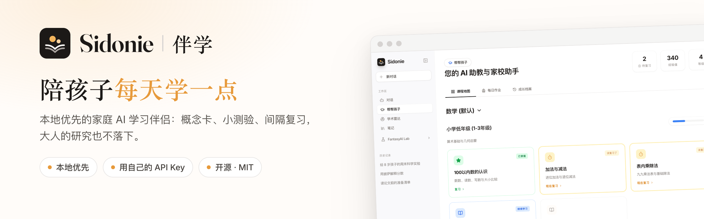

<h3>Sidonie 伴学：本地优先的家庭 AI 学习伴侣</h3>

一个地方，两件事：<b>帮孩子学</b>，每天进步一点；<b>大人的论文学习</b>，<br />
从发现、收藏、阅读、理解、标注、复习到引用，一条龙完成。<br />
全部运行在你的浏览器里，用你自己的 API Key，无需账号，没有服务器。

[](https://github.com/melonlee/sidonie/actions/workflows/ci.yml)
[](./LICENSE)
[](https://melonlee.github.io/sidonie/app/)


**[在线体验](https://melonlee.github.io/sidonie/app/)** · [官网](https://melonlee.github.io/sidonie/) · [功能](#功能) · [论文学习](#大人的论文学习从雷达到引用) · [隐私](#隐私与数据) · [快速开始](#快速开始) · [常见问题](#常见问题) · [English](./README.md)

<sub>由 <a href="https://fantasyailab.com/">FantasyAI Lab</a> 出品</sub>

</div>

---

## 为什么做 Sidonie 伴学

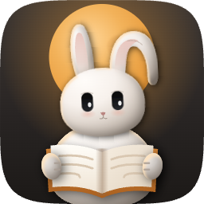

Sidonie 伴学（英文名 Sidonie）以我太太的名字命名，灵感来自我们的孩子。每天看着她们用 AI，我发现这些工具并不是为她们设计的：辅导孩子功课时太泛，想跟上研究进展的大人又要在好几个工具间来回切换。所以我把这些需求收进了一个地方。它最先服务的是我身边最亲近的人；如果对她们有用，也许对你的家庭也有用。

吉祥物是一只陪孩子一起读书的玉兔：我太太最喜欢兔子，所以专门为 Sidonie 选了它。它在月亮前捧着一本打开的书，也是 [FantasyAI Lab](https://fantasyailab.com/) 吉祥物家族的一员。

两大支柱，一个共同的基础：

| | 给谁 | 能做什么 |
| --- | --- | --- |
| **帮孩子学**（帮帮孩子） | 孩子，家长陪伴 | 课程地图、概念与小测验卡片、间隔复习。先学概念，再做练习，到期了再复习。它不只是一个聊天框。 |
| **大人的论文学习**（学术雷达） | 大人 | 学术雷达发现 arXiv 新论文；阅读清单和论文工作台陪你从初读一路走到高亮、术语卡片和现成的引用。 |
| **对话 + 笔记** | 全家 | 多模型对话，以及两大功能都能保存进去的笔记。 |

- **默认保护隐私**：对话、笔记、孩子的学习进度、你的论文和 Key 都只保存在浏览器本地。
- **自带 Key**：支持 Gemini、DeepSeek、Kimi、通义千问。阅读、高亮、笔记和卡片复习不需要 Key。

## 功能

### 帮帮孩子：课程地图、学习卡片、小测验与间隔复习

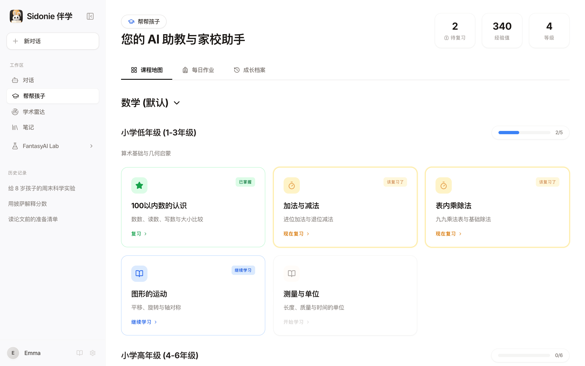

- **课程地图**：内置从小学一年级到大学的数学学习路径。也可以让 AI 为任意学科和年级生成个性化课程。
- **三种学习卡片**：概念讲解（可以继续追问）、选择题小测验，以及可交互的 HTML 可视化演示。
- **间隔复习**：每次答题后会重新安排复习时间（1 天、3 天，之后间隔逐渐拉长）。答错的知识点会更早回来，并标记为「该复习了」。
- **看得见的坚持**：经验值、等级和徽章，加上一份记录每次学习的日历。
- **每日作业记录**：记下老师发的作业要求（文字或照片），AI 可以帮家长解读重点，或生成几道练习题。

<table>
  <tr>
    <td width="50%">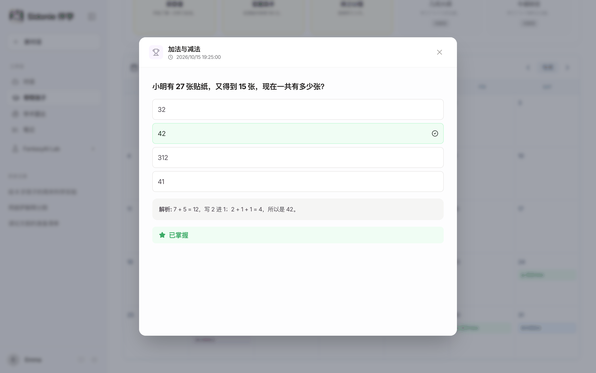</td>
    <td width="50%">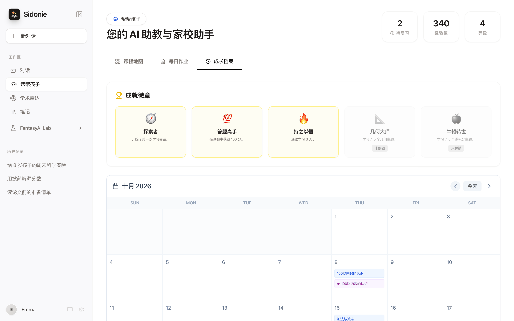</td>
  </tr>
  <tr>
    <td align="center"><sub>带解析的小测验</sub></td>
    <td align="center"><sub>成就徽章与学习日历</sub></td>
  </tr>
</table>

### 大人的论文学习：从雷达到引用

学术雷达过去只是「刷 arXiv 新论文」，现在是一套给大人的完整学习流程：

**发现 → 收藏 → 阅读 → 理解 → 标注 → 复习 → 引用**

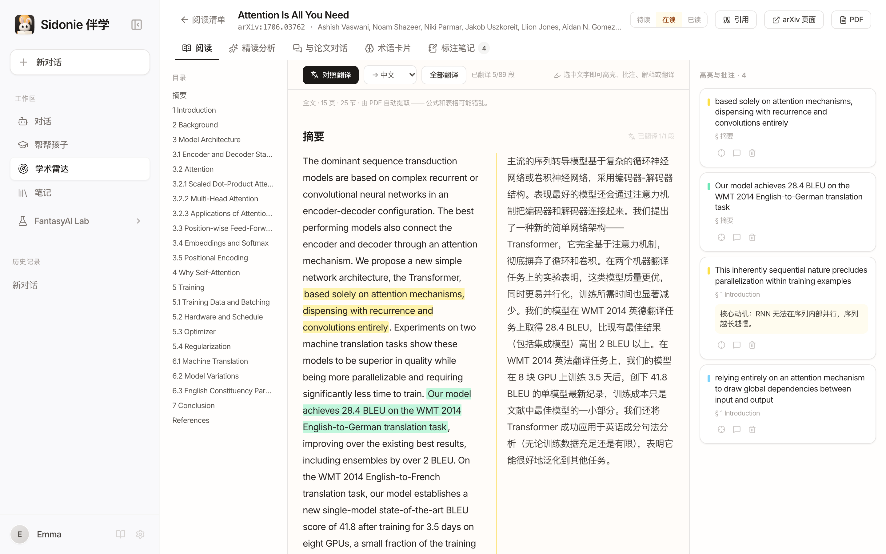

| 环节 | Sidonie 伴学能做什么 |
| --- | --- |
| **发现** | 按主题（LLM、视觉、Agent、机器人、机器学习）浏览 arXiv 最新论文，或搜索关键词。**AI 深度解读** 和 **每日简报** 支持中英文。 |
| **收藏** | 阅读清单：**待读 / 在读 / 已读**、标签、筛选与排序。可从论文流加入、输入 **arXiv 编号或链接** 添加，或 **导入本地 PDF**。顶部统计来自真实数据：清单篇数、本周已读、待复习卡片、连续学习天数。 |
| **阅读** | 在浏览器里从 PDF 提取全文（pdf.js 随应用打包，不走 CDN），按章节排版并带目录。**对照翻译** 把中文或英文译文逐段排在原文旁边。 |
| **理解** | 一键 **结构化精读分析**（一句话总结、研究问题、方法、贡献、实验结果、局限、前置知识、适合谁读）。**与论文对话**：在本地用 BM25 检索段落，回答注明出处章节。 |
| **标注** | 划词即可四色高亮、写批注，或让 AI 解释、翻译这段话。每篇论文一份 Markdown 笔记，**导出到笔记** 一次汇总。 |
| **复习** | 提取关键 **术语卡片**，沿用「帮帮孩子」的间隔重复规则复习；有到期卡片时会提示「今天有 8 张卡片要复习」。 |
| **引用** | 一键复制 **BibTeX**、**APA 7** 或 **GB/T 7714-2015**。 |

<table>
  <tr>
    <td width="50%">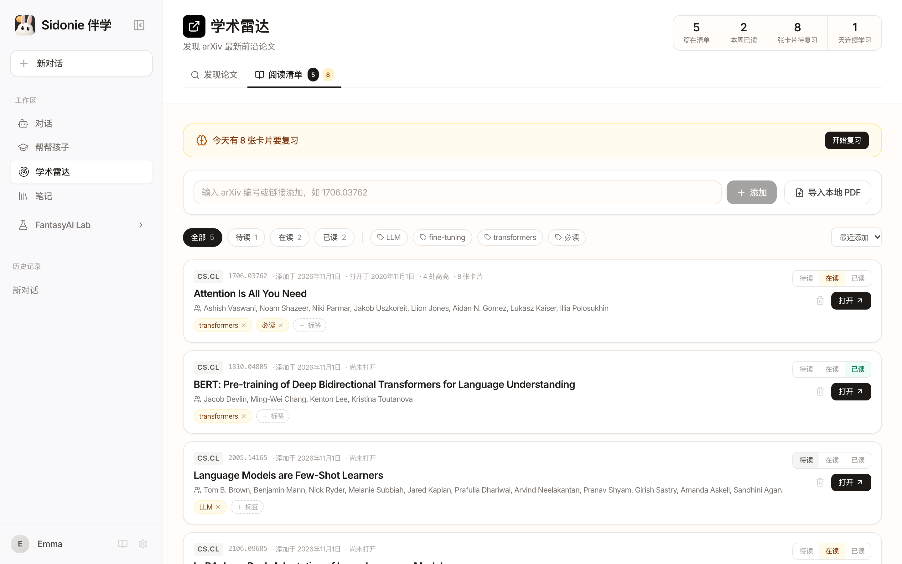</td>
    <td width="50%">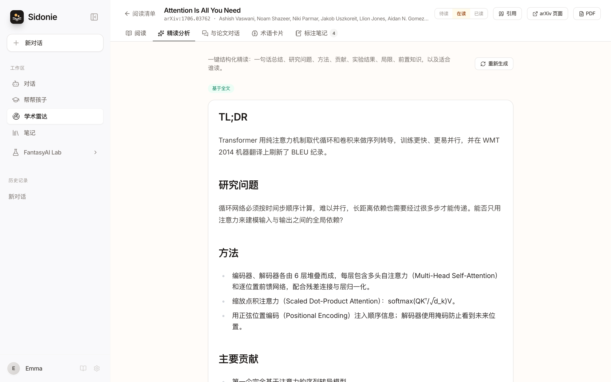</td>
  </tr>
  <tr>
    <td align="center"><sub>阅读清单：状态、标签与学习统计</sub></td>
    <td align="center"><sub>基于全文的结构化精读分析</sub></td>
  </tr>
</table>

使用须知：

- **学习本身不需要 Key**：阅读、高亮、笔记、阅读清单、卡片复习和引用都不需要 API Key；点 AI 按钮时会提示如何配置。
- **全文提取是启发式的**：能处理双栏排版、标题和断词，但公式、表格和图中文字可能错乱；扫描版 PDF（纯图片）没有可提取的文字，只能使用「仅摘要模式」。
- **纯文本模型**（DeepSeek、Kimi、通义千问）收到的是提取后的文字，并按模型上下文自动裁剪。
- **数据存放**：阅读清单、高亮和卡片存于 `localStorage`；PDF、提取的全文、翻译、精读分析和对话存于 IndexedDB。
- 以上截图中的 AI 面板（解释、精读分析、翻译、术语卡片）是手写的演示文本，不是真实的模型输出。

每个功能的详细说明见 **[docs/paper-study.md](./docs/paper-study.md#中文)**。

### 对话与笔记：共同的基础

<table>
  <tr>
    <td width="50%">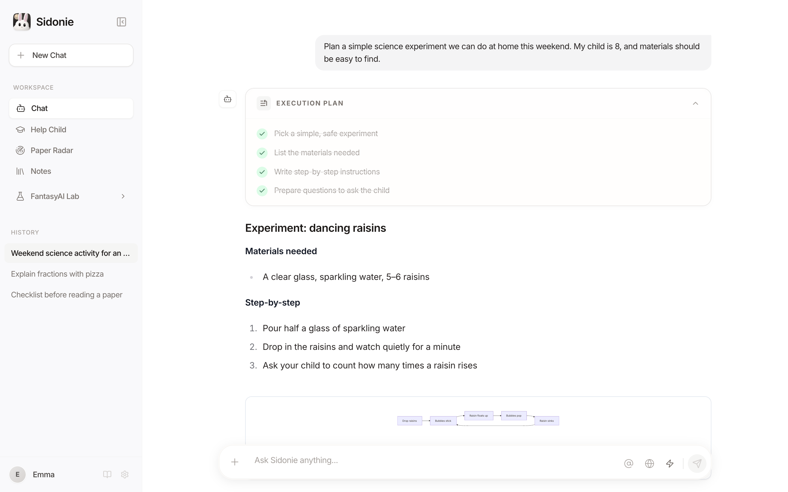</td>
    <td width="50%">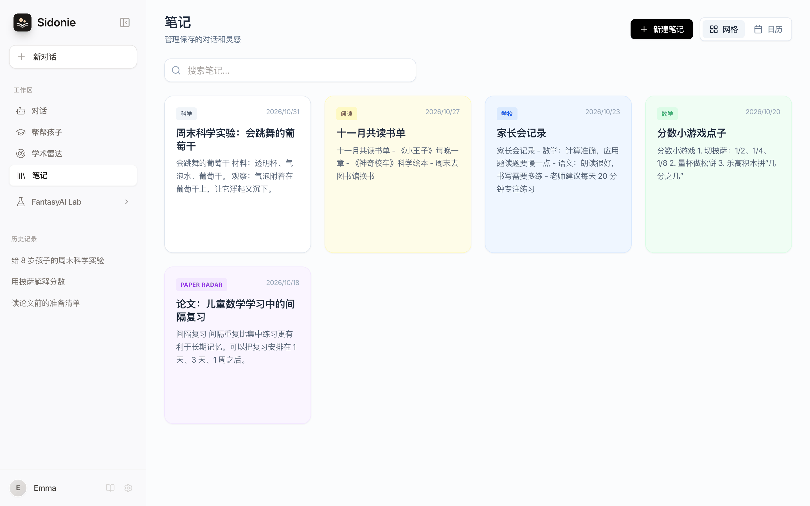</td>
  </tr>
  <tr>
    <td align="center"><sub>对话：执行计划、Markdown、Mermaid 图</sub></td>
    <td align="center"><sub>笔记：标签、网格与日历视图</sub></td>
  </tr>
</table>

- 多会话流式对话，支持上传 PDF、Word（`.docx`）、CSV、TXT 和图片。
- 复杂任务会先给出分步计划。Markdown、代码、表格和 Mermaid 图表直接渲染，HTML 可以实时预览。
- 用 `@` 引用笔记作为上下文，回答可以保存到笔记，也可以导出为 Markdown 或 Word。
- 可选 Google 搜索增强（Gemini）和图片生成（以「画…」开头，需要 Gemini Key）。
- 中英文界面。

### 手机上也能用

<p align="center">
  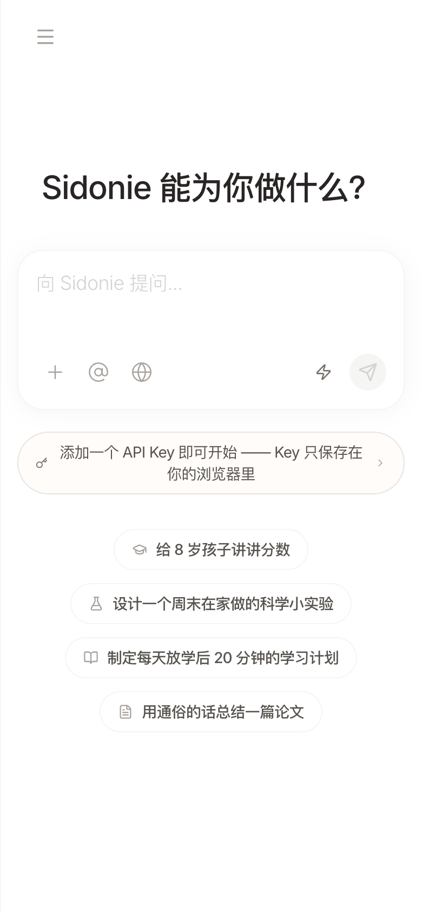
  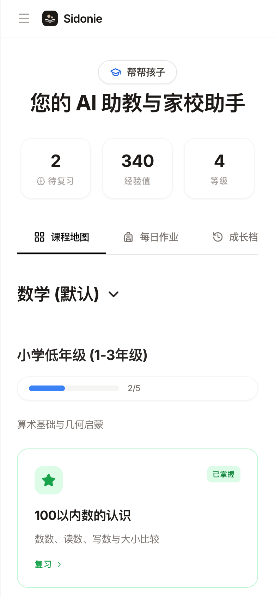
  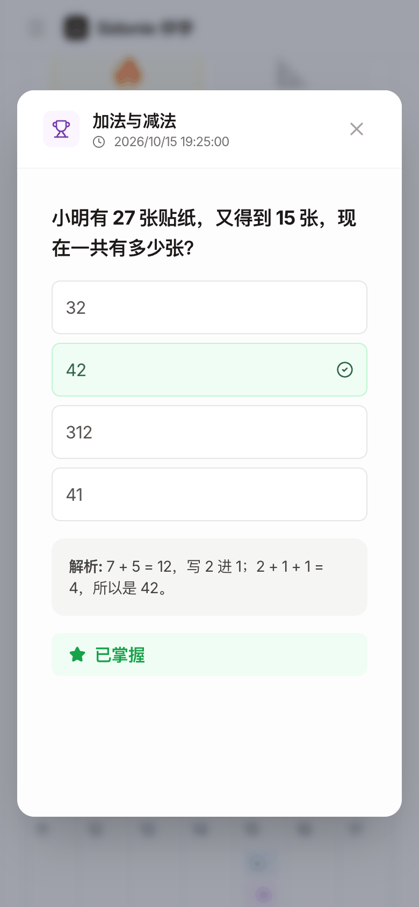
</p>

## 隐私与数据

Sidonie 伴学是一个纯静态网页应用：**没有 Sidonie 后端，不需要账号，也没有任何统计埋点**。

| 内容 | 存在哪里 / 发往哪里 |
| --- | --- |
| 对话、笔记、孩子的学习进度、设置、阅读清单、高亮、卡片 | 仅保存在当前浏览器的 `localStorage` |
| 论文 PDF、提取的全文、翻译、精读分析、论文对话 | 仅保存在当前浏览器的 IndexedDB |
| API Key | 保存在浏览器 `localStorage`，只会发给你选择的模型服务商，**绝不会**被打包进应用代码 |
| AI 请求 | 从浏览器直接发往 Google Gemini、DeepSeek、Moonshot（Kimi）或阿里云百炼（通义千问） |
| 学术雷达搜索与 PDF | 发往 arXiv。arXiv 元数据接口不允许浏览器直接调用（CORS），详见下文 |

**学术雷达与 CORS**：使用 `npm run dev` 或 `npm run preview` 时，搜索请求会经过本地 Vite 服务器内置的代理。GitHub Pages 这类静态部署无法运行代理，此时 Sidonie 会先尝试你自己的代理（若设置了 `VITE_ARXIV_PROXY`），再回退到公共代理 [allorigins.win](https://allorigins.win)。这个第三方服务只会看到你的搜索关键词，使用时界面上也会注明。公共代理可能变慢或不可用，想要最稳定的学术雷达，建议在本地运行。arXiv 的 PDF 允许跨域，所以静态部署上也能获取全文；元数据接口不可用时，**按编号添加** 仍能把论文加入清单。

小贴士：尽量使用设置了额度上限的 API Key。在公共电脑上用完后，请在「设置 → 从此浏览器删除所有 Key」中清除。清空浏览器站点数据会删除所有内容，目前还没有云端同步。

## 快速开始

环境要求：Node.js 20+，以及至少一家服务商的 API Key。

```bash
git clone https://github.com/melonlee/sidonie.git
cd sidonie
npm install
npm run dev        # http://localhost:3000
```

打开「设置 → 模型配置」，粘贴 Key 即可开始，不需要 `.env` 文件。

| 服务商 | Sidonie 中可用的模型 | 获取 Key |
| --- | --- | --- |
| Google Gemini | Gemini 3 Flash / Pro / Flash Lite、图片生成 | [aistudio.google.com/apikey](https://aistudio.google.com/apikey) |
| DeepSeek | DeepSeek V3（`deepseek-chat`）、R1（`deepseek-reasoner`） | [platform.deepseek.com](https://platform.deepseek.com/api_keys) |
| Kimi（Moonshot） | `moonshot-v1-8k` | [platform.moonshot.cn](https://platform.moonshot.cn/console/api-keys) |
| 通义千问（百炼 DashScope） | Qwen Plus、Qwen Max | [bailian.console.aliyun.com](https://bailian.console.aliyun.com/?apiKey=1) |

如果配置了 Gemini Key，帮帮孩子和学术雷达会优先使用 Gemini；否则会自动改用你配置的第一个其他服务商。

其他命令：

```bash
npm run build      # 生产构建，输出到 dist/
npm run preview    # 本地预览构建结果（包含 arXiv 代理）
npm run typecheck  # tsc --noEmit
npm test           # vitest（间隔复习、BM25、引用格式、章节切分、论文存储）
```

### 部署自己的版本

应用是纯静态的，任何静态托管服务都可以部署。

- **GitHub Pages**：`.github/workflows/deploy-pages.yml` 会在每次推送到 `main` 时自动构建并发布。在「Settings → Pages → Source」中选择「GitHub Actions」即可启用。工作流会自动设置 `VITE_BASE=/<仓库名>/`。
- **其他平台**：运行 `VITE_BASE=/你的子路径/ npm run build`。部署在根路径时不用设置。
- **可选**：把 `VITE_ARXIV_PROXY` 设为你自己的 CORS 代理（代理地址前缀，后面会拼接编码后的 arXiv URL），这样学术雷达就不依赖公共代理。在 GitHub 上把它添加为仓库 *Variable* 即可。

**项目官网**：<https://melonlee.github.io/sidonie/>（中英文）。源码在 [`website/`](./website/)，纯 HTML/CSS，无需构建。同一个 GitHub Pages 部署把官网放在根路径、应用放在 `/app/`，详见 [website/README.md](./website/README.md)。

## 技术栈

React 19 · TypeScript · Vite 6 · Tailwind CSS 3（+ typography）· `@google/genai` + OpenAI 兼容接口 · react-markdown · Mermaid · mammoth（Word 解析）· pdf.js · localStorage + IndexedDB（idb-keyval）· Vitest

```
App.tsx                      应用外壳：侧边栏、对话、设置
components/StudyView.tsx     帮帮孩子（课程、卡片、测验、复习、每日作业）
components/AcademicView.tsx  学术雷达（arXiv 论文流、阅读清单、工作台入口）
components/paper/            论文学习：阅读器、PDF 提取、精读分析、问答（BM25）、术语卡片、引用
services/srs.ts              间隔复习调度，帮帮孩子与论文卡片共用
components/NotesView.tsx     笔记
services/geminiService.ts    模型路由、流式输出、BYOK Key 处理
constants.ts                 模型、提示词、默认课程、中英文文案
docs/assets/brand/           玉兔图标与 favicon、Logo（含中文字标）、横幅、海报（src/ 下有 SVG 母版和生成脚本）
website/                     项目官网（纯静态，可独立部署，见 website/README.md）
```

## 路线图

下面是接下来想做的方向，目前都还没有实现，欢迎一起参与：

- [ ] 一个家庭支持多个孩子档案
- [ ] 一键导出 / 导入全部数据（JSON 备份）
- [ ] 更多内置课程（语文、英语、科学）
- [ ] 可安装的 PWA，离线查看已保存内容
- [ ] 单文件 arXiv 代理模板（如 Cloudflare Worker）
- [ ] 模型路由的自动化测试（复习调度和论文工具已有测试）

## 常见问题

<details>
<summary><b>收费吗？</b></summary>

Sidonie 伴学本身免费开源（MIT）。模型调用费用由你自己的 Key 向服务商支付，很多服务商都有免费额度。
</details>

<details>
<summary><b>需要自己搭服务器吗？</b></summary>

不需要。在自己电脑上 `npm run dev` 就能用，也可以把静态构建部署到任何地方。唯一可选的服务端部分，是静态部署时给学术雷达用的 CORS 代理。
</details>

<details>
<summary><b>我的 API Key 安全吗？</b></summary>

Key 以明文形式保存在浏览器的 `localStorage` 中，只会发送给对应的服务商。能访问这个浏览器配置文件的人也能读取它，所以建议使用有额度上限的 Key，并在共享设备上用完即删。
</details>

<details>
<summary><b>为什么在线体验里的学术雷达有时加载失败？</b></summary>

arXiv 不允许浏览器直接请求，在线体验依赖的公共 CORS 代理有时不可用。可以在本地运行（`npm run dev`），或设置 `VITE_ARXIV_PROXY` 使用自己的代理。
</details>

<details>
<summary><b>适合什么年龄和学科？</b></summary>

内置路径是从小学低年级到大学的数学。「创建课程」可以让模型为任意学科和年级生成课程大纲。
</details>

<details>
<summary><b>孩子可以自己用吗？</b></summary>

它的设计初衷是家长陪孩子一起用。AI 生成的讲解和题目可能有错，请和孩子一起核对。
</details>

## 参与贡献

欢迎提交 Issue 和 Pull Request。提交 PR 前请先运行：

```bash
npm run typecheck && npm test && npm run build
```

## 关于作者

Sidonie 伴学由 **Melon（李辉）** 开发。他是一名 AI 全栈工程师，也是 [FantasyAI Lab](https://fantasyailab.com/) 的创始人，专注于可靠的 AI Agent、多智能体系统和实用 AI 产品。更多信息见 [fantasyailab.com](https://fantasyailab.com/) 与 [Melon（李辉）个人页](https://fantasyailab.com/melon-lihui.html)。

## Star 趋势

[](https://star-history.com/#melonlee/sidonie&Date)

## 许可证

[MIT](./LICENSE) © 2026 Melon（李辉）
