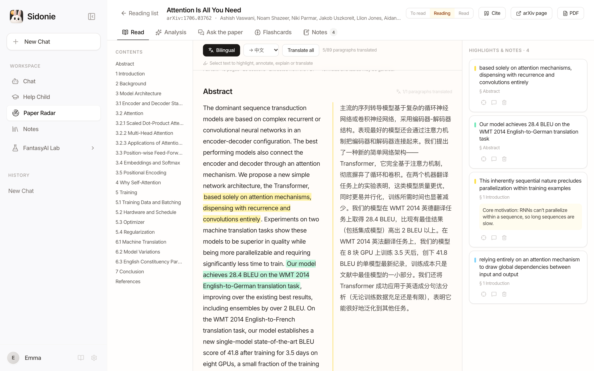
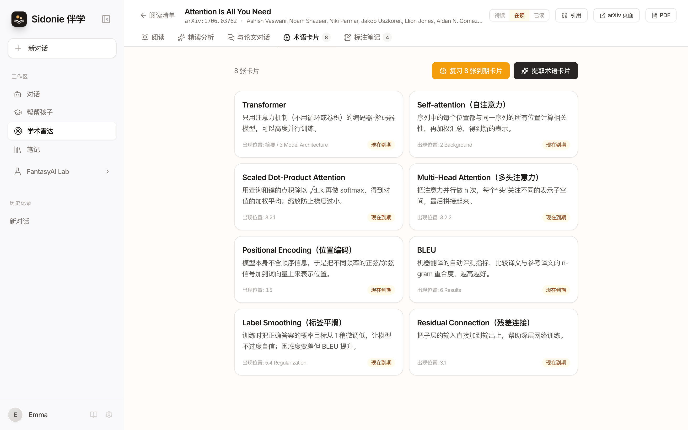

# Paper study workflow / 论文学习工作流

> The full guide behind the paper study section of the [README](../README.md) / [中文 README](../README_zh.md).
> Screenshots live in `docs/screenshots/paper-*.png` (`-zh` for Chinese). AI panels in the screenshots show
> hand-written demo content; no model output is included. / 截图中的 AI 面板为手写演示文本，并非真实模型输出。

  
  

---

## English

Paper Radar is no longer just a feed of new arXiv papers. It now supports a full study loop:
**discover → collect → read → understand → annotate → retain → cite**. Everything stays in your
browser: the reading list, highlights and flashcards in localStorage; PDFs, extracted text,
translations, analyses and chats in IndexedDB.

### Reading list
- Save a paper from the feed (**Save** on a card, or in the detail view), add one by **arXiv ID or
  URL** (`1706.03762`, `arXiv:1706.03762v7`, `https://arxiv.org/abs/…`), or **import a local PDF**
  (title and authors editable).
- Status **To read / Reading / Read**, tags, added and last-opened dates; filter by status or tag,
  sort by added, opened or title. Opening a paper moves it to *Reading*.
- The header shows real numbers computed from your list: papers in the list, read this week,
  cards due, and your study streak. Due flashcards also appear as a banner: "8 cards to review today".

### Paper workspace
Open any saved paper for a focused reading view.

| Tab | What it does |
| --- | --- |
| **Read** | Fetches the arXiv PDF and extracts the text with pdf.js (loaded on demand, worker bundled — no CDN) into sections and paragraphs, with a contents sidebar. If the download fails, drop or upload the PDF; otherwise you read the abstract. |
| **Bilingual** (in Read) | Paragraph-by-paragraph translation next to the original, per section or all at once, with progress and a stop button. Target: Chinese or English. Cached per paper. |
| **Select text** (in Read) | Highlight in four colours, add a note, **Explain** or **Translate** the passage. An explanation can be saved as a flashcard. Highlights are listed in the side panel; click one to jump back. |
| **Analysis** | One-click structured close reading: TL;DR, research question, method, contributions, experiments & results, limitations, prerequisites, who should read it. Uses the full text when loaded (trimmed to the provider's context size), otherwise the abstract — and says which. Cached, with a regenerate button. |
| **Ask the paper** | Q&A grounded in the paper. The most relevant passages are found locally with BM25 (no embeddings server); answers cite the sections they used. Chinese questions about English papers are first turned into English keywords. |
| **Flashcards** | Extracts 8–12 key terms with plain explanations and where they appear. Review uses the same spaced-repetition schedule as Help Child (1 day, 3 days, then growing; a miss comes back right away). |
| **Notes** | All highlights with their notes, a Markdown note for the paper, and **Export to Notes**: metadata, TL;DR, highlights with notes, your notes and the citation, tagged `Paper` plus the paper's tags. |
| **Cite** (header) | Copy **BibTeX**, **APA 7** or **GB/T 7714-2015**; links to the arXiv page and PDF. |

### Good to know
- **Bring your own key.** Without a key, every AI button shows a friendly prompt that opens Settings.
  Reading, highlighting, notes, the list, flashcard review and citations work without any key.
- **Text-only providers.** DeepSeek, Kimi and Qwen receive extracted text, not the PDF. Analyses
  are trimmed to fit the model (about 12k characters for `moonshot-v1-8k`, 60k for DeepSeek/Qwen,
  far more for Gemini).
- **PDF extraction is heuristic.** Two-column layouts, headings and hyphenation are handled; formulas,
  tables and figure text can be garbled. Scanned PDFs (images only) have no text to extract.
- **arXiv access.** `npm run dev` / `npm run preview` proxy the arXiv API and PDFs. arXiv PDFs allow
  cross-origin requests, so full text also works on static hosting (e.g. GitHub Pages). The metadata API
  doesn't: static builds use `VITE_ARXIV_PROXY` if set, then the public proxy `api.allorigins.win`. If
  both are down, **Add by ID** still saves the paper and fills in its title and abstract from the PDF.

---

## 中文

学术雷达不再只是「刷 arXiv 新论文」，而是一套完整的学习流程：
**发现 → 收藏 → 阅读 → 理解 → 标注 → 巩固 → 引用**。所有数据都留在你的浏览器里：阅读清单、高亮、卡片存于
localStorage；PDF、提取的全文、翻译、精读分析和对话存于 IndexedDB。

### 阅读清单
- 在论文卡片或详情里点 **加入清单**；也可以输入 **arXiv 编号或链接** 添加（如 `1706.03762`、
  `arXiv:1706.03762v7`、`https://arxiv.org/abs/…`），或 **导入本地 PDF**（标题、作者可编辑）。
- 状态 **待读 / 在读 / 已读**，支持标签、添加日期、最近打开时间；可按状态、标签筛选，按添加、打开时间或标题排序。打开论文会自动标为「在读」。
- 顶部统计全部来自你的真实数据：清单篇数、本周已读、待复习卡片、连续学习天数。有到期卡片时还会提示「今天有 8 张卡片要复习」。

### 论文工作台
打开清单里的任意论文，进入专注阅读视图。

| 功能 | 说明 |
| --- | --- |
| **阅读（全文获取）** | 下载 arXiv PDF，用 pdf.js（按需加载，worker 随应用打包，不走 CDN）提取文字，按章节和段落排版，并带目录。下载失败时可以把 PDF 拖进来或手动上传；都不行就是「仅摘要模式」。 |
| **对照翻译** | 原文与译文逐段并排，可按节翻译或全部翻译，有进度和停止按钮；目标语言可选中文或英文，结果按论文缓存。 |
| **划词操作** | 选中文字即可四色高亮、添加批注、让 AI **解释** 或 **翻译**；解释可一键做成卡片。高亮列在右侧面板，点击即可跳回原文。 |
| **结构化精读分析** | 一键生成：一句话总结、研究问题、方法、主要贡献、实验与结果、局限、前置知识、适合谁读。有全文时基于全文（按模型上下文自动裁剪），否则基于摘要并明确标注。结果会缓存，可重新生成。 |
| **与论文对话** | 回答基于论文内容：在本地用 BM25 检索最相关的段落（无需向量数据库），并注明出处章节。用中文问英文论文时，会先把问题转成英文关键词再检索。 |
| **术语卡片** | 提取 8–12 个关键术语，附通俗解释和出现位置。复习沿用「帮帮孩子」的间隔重复规则（1 天、3 天，之后逐步拉长；忘了的卡片会马上再出现）。 |
| **标注笔记** | 汇总所有高亮和批注，每篇论文一份 Markdown 笔记；**导出到笔记** 会生成包含元数据、TL;DR、高亮与批注、我的笔记和引用的笔记，并打上「论文」及论文自身的标签。 |
| **引用**（顶部） | 一键复制 **BibTeX**、**APA 7**、**GB/T 7714-2015**；可直接打开 arXiv 页面和 PDF。 |

### 使用须知
- **自带 Key。** 没有配置 Key 时，所有 AI 按钮都会给出友好提示并可直接打开设置。阅读、高亮、笔记、清单、卡片复习和引用都不需要 Key。
- **纯文本模型。** DeepSeek、Kimi、通义千问收到的是提取后的文字而不是 PDF；精读分析会按模型裁剪长度（`moonshot-v1-8k` 约 1.2 万字符，DeepSeek / Qwen 约 6 万，Gemini 更多）。
- **PDF 提取是启发式的。** 能处理双栏排版、标题和断词，但公式、表格和图中文字可能错乱；扫描版 PDF（纯图片）没有可提取的文字。
- **arXiv 访问。** `npm run dev` / `npm run preview` 内置 arXiv API 和 PDF 代理。arXiv 的 PDF 允许跨域，所以静态部署（如 GitHub Pages）上也能获取全文；元数据接口不允许跨域，静态版本会依次尝试 `VITE_ARXIV_PROXY` 和公共代理 `api.allorigins.win`。两者都不可用时，**按编号添加** 仍会先把论文加入清单，获取全文后自动补全标题和摘要。
